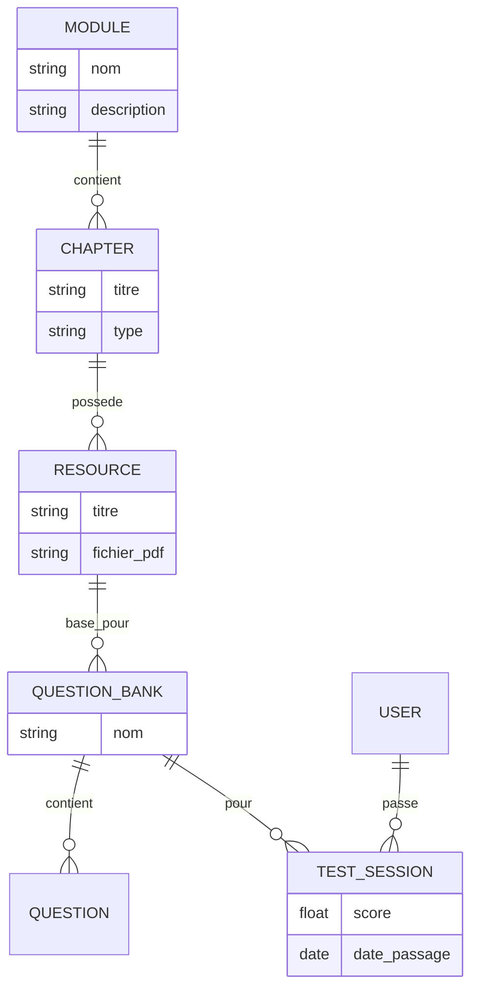

# 🎓 Plateforme E-Learning Universitaire (Secteur Informatique)


> **Créateur et Responsable de l'Application :** Homam Dany

Bienvenue sur le dépôt officiel de notre **Plateforme E-Learning Nouvelle Génération**. Conçue spécialement pour les étudiants en informatique, cette solution **Web & Mobile** intègre les dernières avancées en Intelligence Artificielle pour offrir un apprentissage interactif, personnalisé et performant.

---

## 🌟 Fonctionnalités Clés

### 🧠 Intégration de l'Intelligence Artificielle
- **Génération de QCM Dynamiques** : L'IA analyse le contenu exact des supports de cours (PDF, Textes) et génère des QCM sur-mesure pour tester les connaissances.
- **Code Playground Intelligent** : Un éditeur de code multi-langages (Python, Java, C++, PHP, SQL...) qui évalue le code des étudiants, trouve les erreurs et propose des corrections en temps réel.
- **Analyse des Performances** : L'IA identifie les points forts et les axes d'amélioration (Points Faibles) de chaque étudiant en fonction de ses résultats aux tests.

### 📚 Gestion Pédagogique Avancée
- **Arborescence Intelligente** : Organisation claire en *Modules* > *Cours* / *TD*.
- **Visualisation Intégrée** : Lecteur de documents PDF intégré, pas besoin de télécharger les fichiers.
- **Tableaux de Bord Riches** : Statistiques en temps réel, graphiques de progression, et suivi des séries de révisions (Streaks).

---

## 🏗️ Architecture du Projet

L'application repose sur une architecture moderne séparant clairement le backend (API) du frontend (Web/Mobile).

```mermaid
graph TD
    Client_Mobile[📱 Application Mobile<br/>React Native / Expo] --> |API REST / JWT| Backend
    Client_Web[💻 Application Web<br/>React Native Web] --> |API REST / JWT| Backend
    
    subgraph Backend [Backend Django]
        API[API DRF]
        Auth[Authentification JWT]
        AI_Service[Service IA Gemini/OpenAI]
        DB[(Base de Données<br/>SQLite/PostgreSQL)]
        
        API --> Auth
        API --> AI_Service
        API --> DB
    End
    
    AI_Service --> |Requêtes LLM| Cloud_AI[Google Gemini API]
```

---

## 📊 Modèle de Données (Aperçu)

Voici comment les données principales sont structurées dans la base de données :



---

## 📈 Tableaux de Bord & Statistiques (Données Réelles)

L'application intègre des tableaux de bord dynamiques avec de véritables statistiques tirées de la base de données :

- **Pour l'Administrateur** : 
  - Suivi du nombre total d'utilisateurs, de documents et de quiz joués.
  - Répartition des ressources (Cours, Ateliers, Examens) via des graphiques.
  - Identification des étudiants en difficulté (Moyenne < 10/20).

- **Pour l'Étudiant** :
  - **Graphiques Radar / Barres** : Affichage des performances par module.
  - Compteur de séries (Streaks) pour encourager la régularité.
  - Moyenne générale calculée sur les `TestSessions`.

---

## 🛠️ Stack Technique Détaillée

| Composant | Technologie | Description |
|-----------|-------------|-------------|
| **Frontend** | React Native, Expo | Application hybride iOS, Android et Web. |
| **Backend** | Django, Django REST | API robuste et sécurisée. |
| **Authentification**| JWT (SimpleJWT) | Tokens sécurisés avec gestion des rafraîchissements. |
| **Design / UI** | Lucide Icons, Glassmorphism | Interface utilisateur premium et moderne. |
| **Intelligence**| LLM (Gemini API) | Cœur de la génération de QCM et correction de code. |

---

## ⚙️ Installation & Démarrage Rapide

> [!IMPORTANT]
> Assurez-vous d'avoir Python 3.10+ et Node.js installés sur votre machine avant de commencer.

### 1. Préparation du Backend (Django)

```bash
# Activer l'environnement virtuel
.\venv\Scripts\activate

# Appliquer les migrations de la base de données
python manage.py migrate

# Lancer le serveur local
python manage.py runserver
```

### 2. Lancement du Frontend (React Native)

Ouvrez un nouveau terminal et naviguez dans le dossier `mobile` :

```bash
cd mobile

# Installer les dépendances
npm install

# Démarrer la version Web
npm run web

# Démarrer sur mobile (Expo Go)
npx expo start
```

---

> [!NOTE]
> **Création & Propriété** : Cette plateforme a été imaginée, conçue et développée par **Homam Dany**. Toute reproduction ou utilisation non autorisée est interdite.
