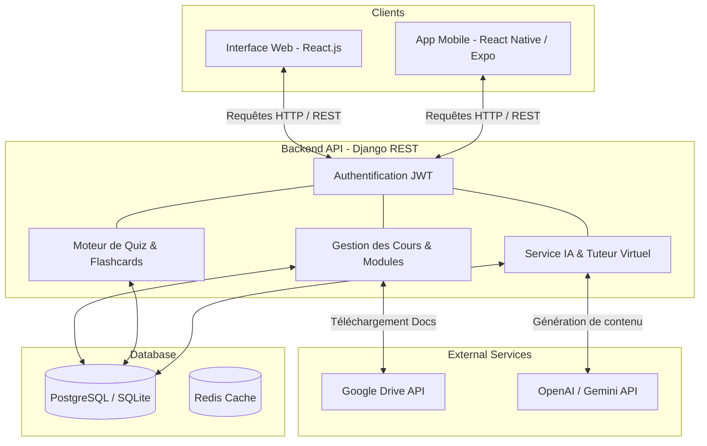
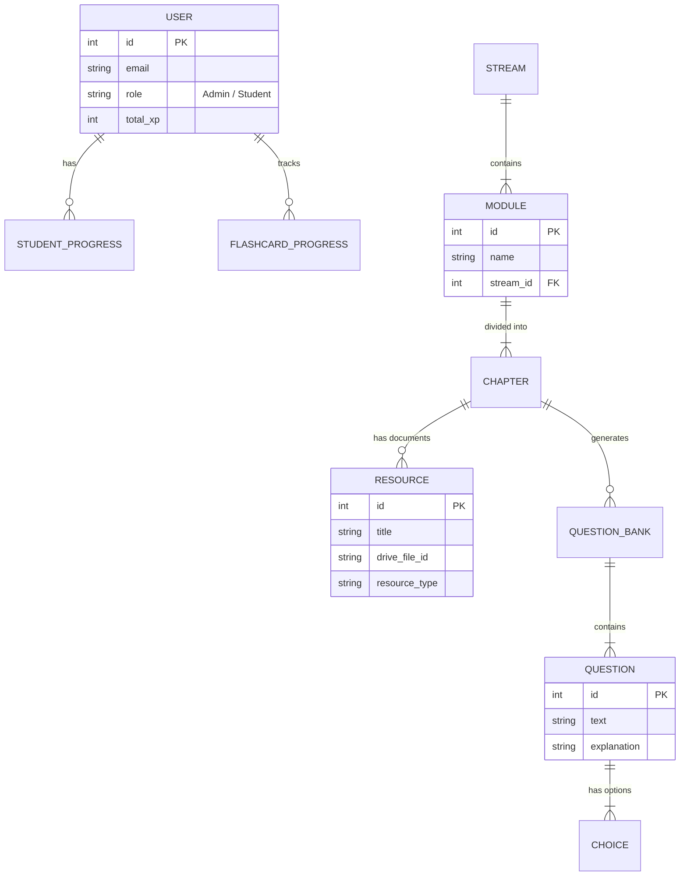

<div align="center">
  
  
  # EduPlatform - Plateforme Universitaire d'Apprentissage (Web & Mobile)
  
  **Une solution complète et intelligente pour la gestion des cours, l'apprentissage interactif, et l'évaluation continue dans le secteur informatique.**

  [](https://reactjs.org/)
  [](https://www.djangoproject.com/)
  [](https://reactnative.dev/)
  [](https://www.postgresql.org/)
</div>

<br />

## 🌟 Présentation du Projet

**EduPlatform** est un écosystème d'apprentissage de nouvelle génération conçu spécifiquement pour le secteur universitaire informatique. Il se divise en deux interfaces complémentaires :
1. **Un Portail Web Administration & Étudiant** : Pour la gestion avancée des ressources, la visualisation des statistiques, et l'accès aux cours.
2. **Une Application Mobile Interactive** : Pour l'apprentissage en mobilité, la révision intelligente (Flashcards, QCM), et l'interaction avec le Tuteur IA.

---

## ✨ Fonctionnalités Clés

### 💻 Portail Web (Administration & Étudiant)
- **Tableau de Bord Analytique** : Suivi des statistiques d'apprentissage en temps réel (taux de réussite, progression par module).
- **Gestion des Ressources** : Interface pour les professeurs permettant d'importer des fichiers (PDF, Word, PPT) via une intégration **Google Drive API**.
- **Générateur de Quiz IA** : Création automatique de QCM pertinents à partir des fichiers de cours téléversés.
- **Défis de Code (Code Challenges)** : Un IDE intégré pour s'exercer à la programmation avec correction automatisée.

### 📱 Application Mobile (React Native)
- **Lecteur de Documents Intégré (In-App Viewer)** : Consultation fluide des PDF et présentations sans quitter l'application.
- **Révisions Intelligentes** : Système de Flashcards avec algorithme de répétition espacée.
- **Tuteur IA Intégré (Chatbot)** : Assistant d'intelligence artificielle disponible 24/7 pour expliquer des concepts complexes et répondre aux questions de l'étudiant.
- **Système de Gamification** : Badges, points d'expérience (XP), et séries de connexion (Streaks).

---

## 🏗 Architecture & Modélisation UML

Le système repose sur une architecture moderne de type **Microservices-Oriented** (Backend API-first) assurant sécurité, scalabilité et séparation des responsabilités.

### Diagramme d'Architecture Globale (Mermaid)



### Modèle Relationnel des Données (UML)



---

## 🛠 Stack Technique

* **Frontend Web** : React.js, Vite, Tailwind CSS, Recharts, Lucide-React.
* **Frontend Mobile** : React Native, Expo, React Navigation, Axios.
* **Backend** : Python, Django, Django REST Framework, Celery (Tâches asynchrones).
* **Base de données** : PostgreSQL (Production), SQLite (Développement).
* **Authentification** : JWT (JSON Web Tokens) via `djangorestframework-simplejwt`.
* **Services Tiers** : Google Drive API (Stockage cloud), API LLM (Génération de contenu pédagogique).

---

## 📈 Statistiques du Projet

- **+40** Modules de cours gérés.
- **Intégration Cloud** : Chargement fluide des documents via liens Drive sécurisés.
- **Sécurité** : Expiration intelligente des sessions JWT (Sécurité niveau production).

---

## 🚀 Installation & Déploiement Local

### Prérequis
* Python 3.10+
* Node.js 18+ & npm
* Expo CLI

### 1. Cloner le projet
```bash
git clone https://github.com/Homam-Dany/Application_Web_et_Mobile_des_Cours_Universitaires_Secteur_Informatique.git
cd Application_Web_et_Mobile_des_Cours_Universitaires_Secteur_Informatique
```

### 2. Configuration du Backend (Django)
```bash
# Créer et activer l'environnement virtuel
python -m venv venv
source venv/bin/activate  # Sur Windows: venv\Scripts\activate

# Installer les dépendances
pip install -r requirements.txt

# Migrations & Lancement
python manage.py migrate
python manage.py runserver
```

### 3. Configuration du Web (React)
```bash
cd frontend
npm install
npm run dev
```

### 4. Configuration de l'Application Mobile (React Native)
```bash
cd mobile
npm install
npx expo start
```

---

## 🤝 Contribution
Toute contribution (Pull Requests, signalement de bugs) est la bienvenue pour améliorer la plateforme.

<div align="center">
  <p>Fait avec ❤️ par l'équipe de développement.</p>
</div>
